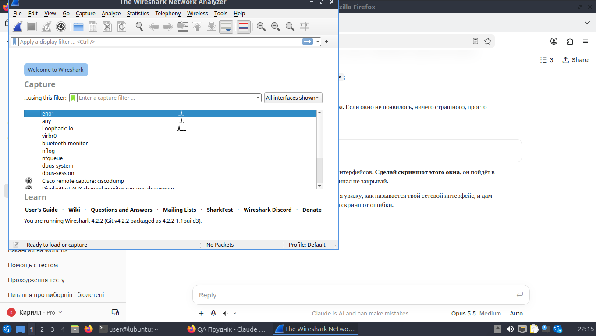
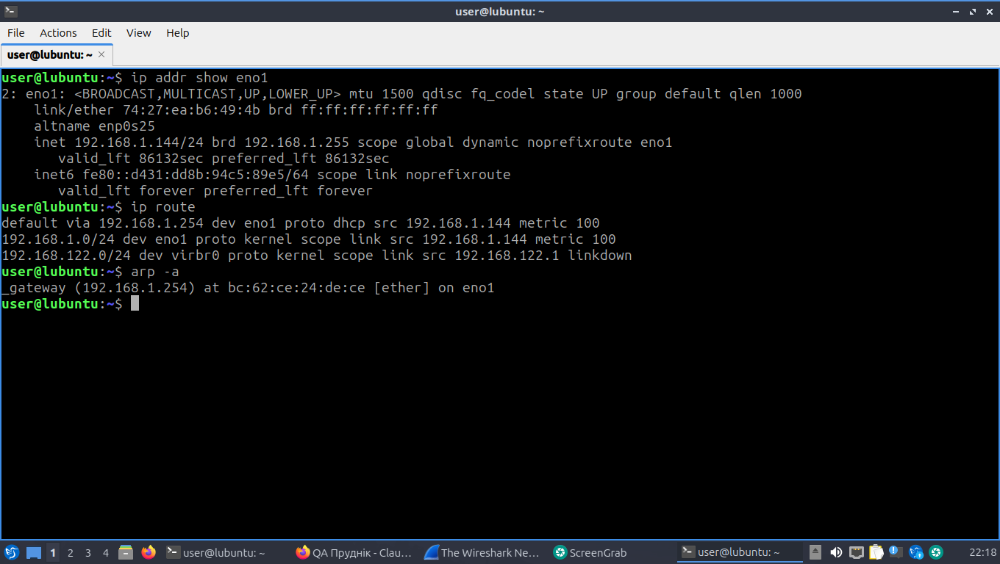
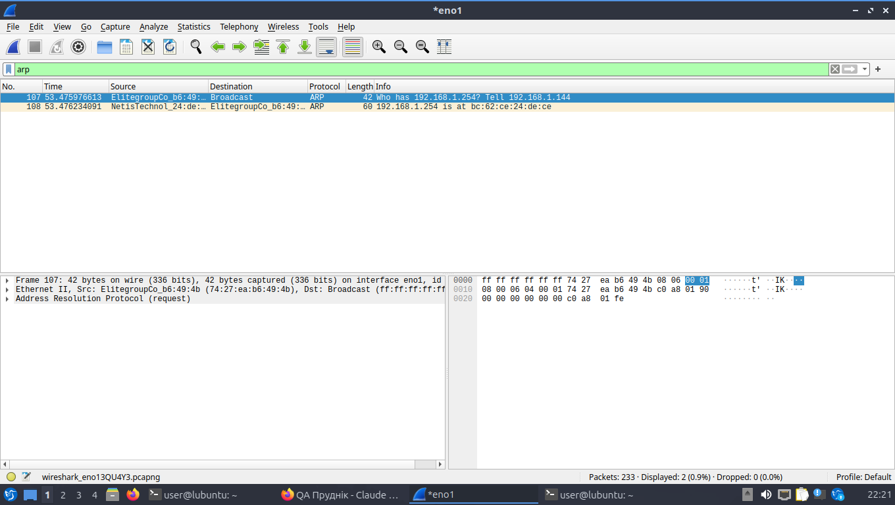
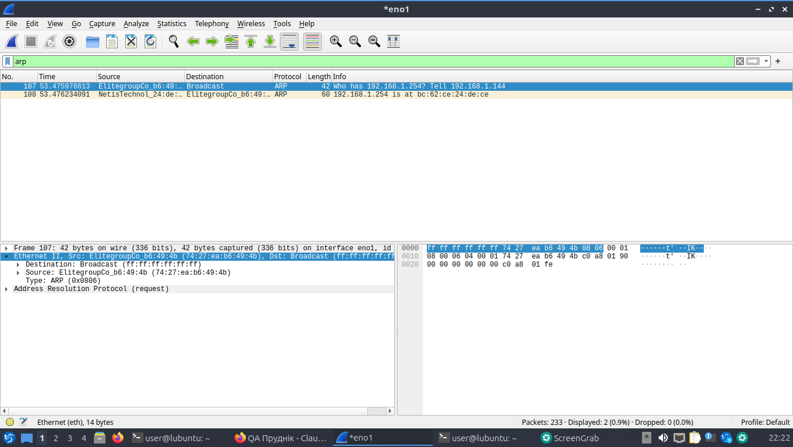
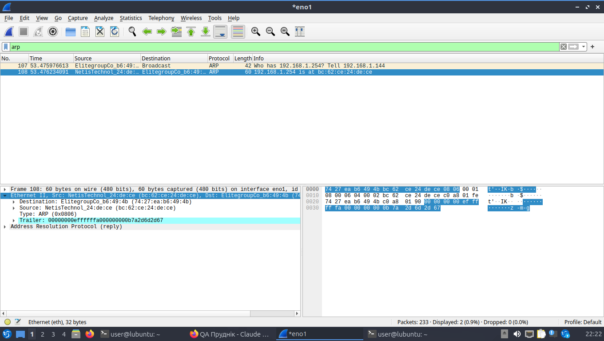
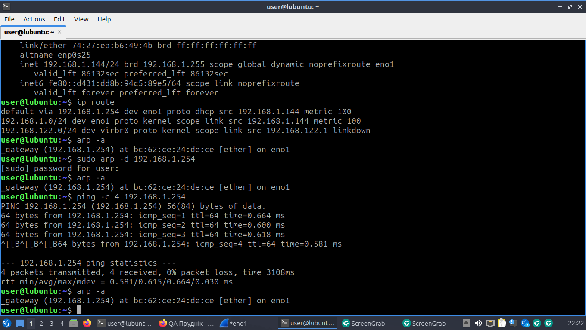
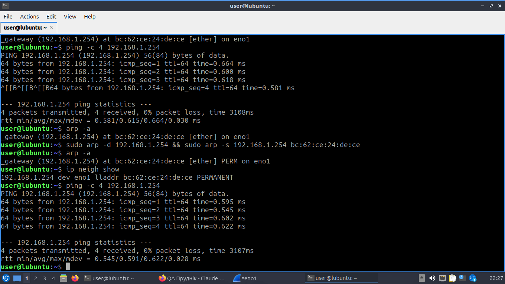
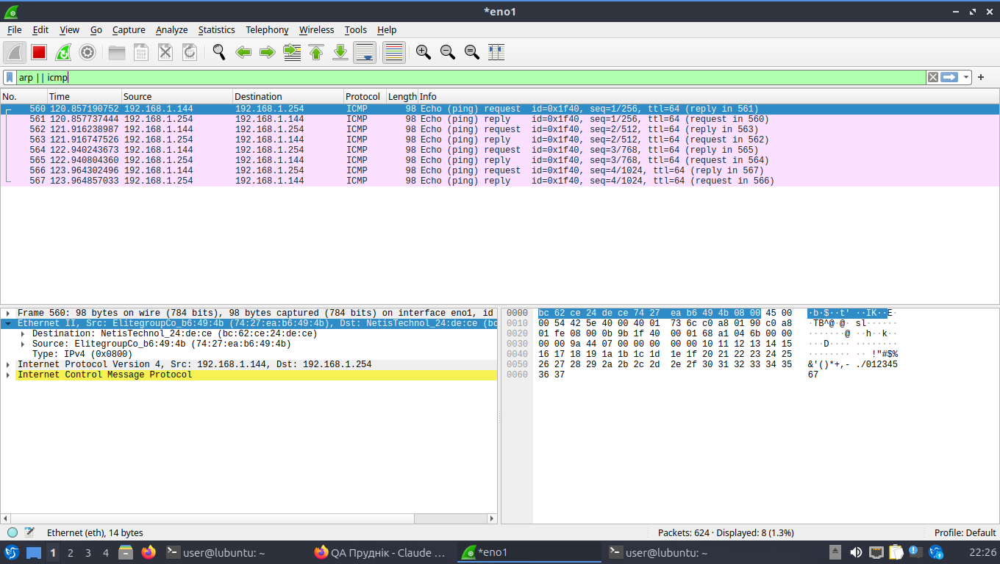

# Лабораторна робота №2. Налаштування мережного оточення та тестування протоколу ARP

**Виконав:** Пруднік Дмитро, група ІК-34
**Варіант:** 2 (останні цифри залікової книжки 11, 11 mod 3 = 2)

## Мета

Навчитися налаштовувати мережне оточення, використовувати Wireshark для аналізу трафіку, дослідити отримання MAC-адреси за IP-адресою протоколом ARP, роботу з ARP-кешем і скласти тест-кейси для протоколу ARP.

## Тестове оточення

| Пристрій | IP-адреса | MAC-адреса |
|---|---|---|
| ПК (Lubuntu, інтерфейс `eno1`) | 192.168.1.144 | 74:27:ea:b6:49:4b |
| Роутер (шлюз) | 192.168.1.254 | bc:62:ce:24:de:ce |

Підключення через Ethernet. Інструменти: `ip`, `arp` (net-tools), `ping`, Wireshark 4.2.2.

## Хід роботи

### 1. Встановлення Wireshark

```bash
sudo apt update
sudo apt install -y wireshark
sudo wireshark
```



### 2. Мережні налаштування та ARP-таблиця

```bash
ip addr show eno1
ip route
arp -a
```



### 3. Отримання MAC-адреси за IP (ARP request / reply)

```bash
sudo arp -d 192.168.1.254
arp -a
ping -c 4 192.168.1.254
arp -a
```

Фільтр Wireshark: `arp`.






### 4. Статичний запис у ARP-таблиці (варіант 2)

```bash
sudo arp -d 192.168.1.254 && sudo arp -s 192.168.1.254 bc:62:ce:24:de:ce
arp -a
ip neigh show
ping -c 4 192.168.1.254
sudo arp -d 192.168.1.254
```

Фільтр Wireshark: `arp || icmp`.




## Тестова документація

Тест-кейси: [test-cases.md](test-cases.md)

| ID | Назва | Статус |
|---|---|---|
| TC-ARP-02 | Статичний запис у ARP-таблиці та ping з відстеженням трафіку (варіант 2) | Passed |
| TC-ARP-03 | Отримання MAC за IP та оновлення ARP-таблиці після ARP-reply (власний) | Passed |

## Висновки

ARP-запит надсилається широкомовно і містить нульову Target MAC, а відповідь приходить адресно і містить шукану MAC-адресу, яка додається до ARP-таблиці. Статичний запис має статус PERMANENT, і при ping до цього пристрою ПК не надсилає ARP-запитів.
